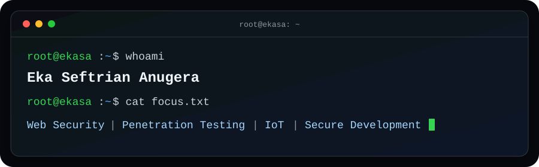
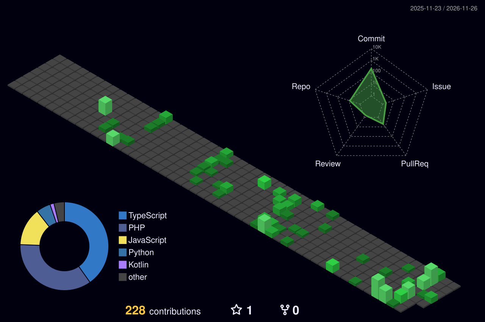

<div align="center">
  

  <br />

  <a href="https://ekasa.my.id"></a>
  <a href="https://linkedin.com/in/ekasa"></a>
  <a href="mailto:ekaseftrian@protonmail.com"></a>
</div>

## hey, I'm Eka 👋

```console
root@ekasa:~$ whoami
just a guy from Indonesia who likes breaking web apps (legally)
and building stuff to see how it works.
```

Mostly I poke around web security: pentesting, CTFs, and some bug bounty when I have time. Outside of that I build websites, play with ESP boards and Arduino, and spend way too much time digging through random corners of the internet just to learn something new.

## what I'm up to

- getting better at web pentesting, one CTF at a time
- hunting bugs whenever I get the chance
- making small tools that help with security testing
- building IoT stuff that hopefully doesn't get hacked

## tools I use

<p align="center">
  
</p>

## the city I'm building



## say hi

Want to talk security, IoT, or just share a cool CTF challenge? Hit me up on [LinkedIn](https://linkedin.com/in/ekasa) or [email](mailto:ekaseftrian@protonmail.com).

<div align="center">
  <sub>keep learning and stay alive</sub>
</div>
